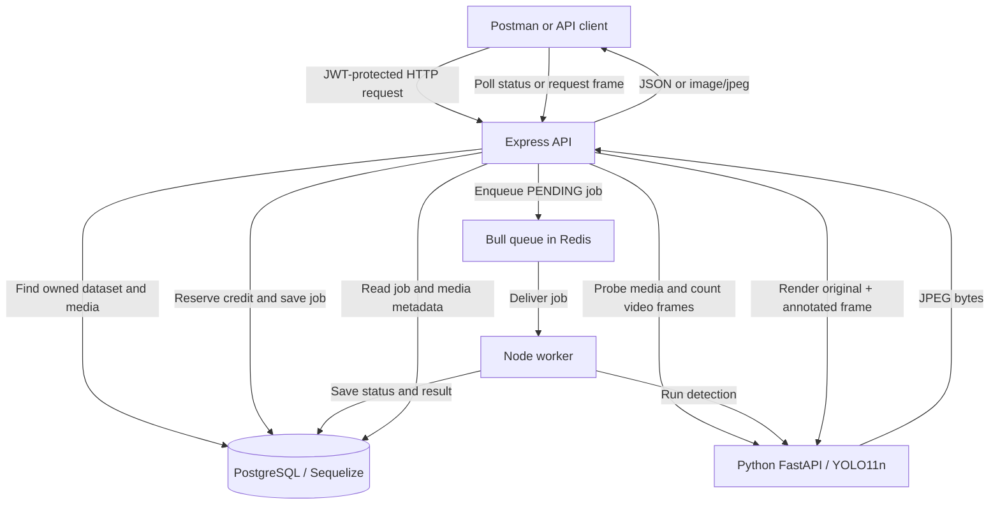
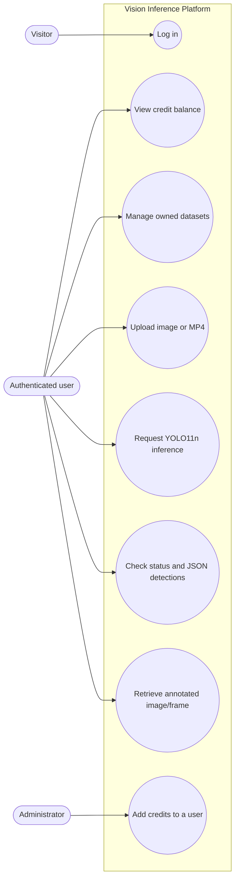
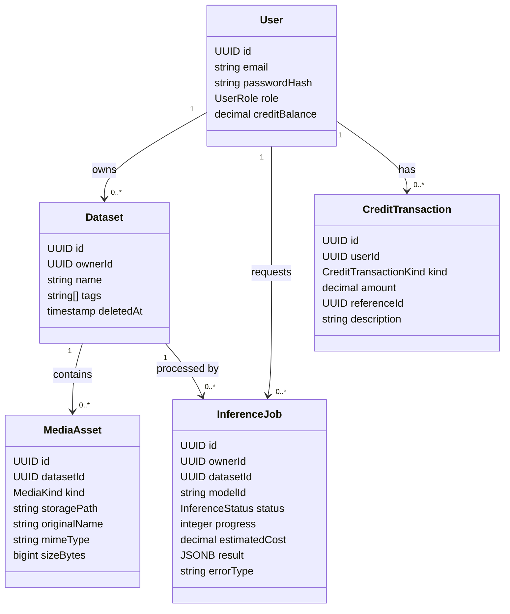

# Vision Inference Platform


A TypeScript backend for managing image and video datasets and running asynchronous object detection with the pretrained **YOLO11n** model. Users authenticate with JWT, manage datasets, upload media, spend credits, and retrieve inference results.

## Table of Contents

- [1. Project Description](#1-project-description)
- [2. Project Objectives and Features](#2-project-objectives-and-features)
- [3. Architecture](#3-architecture)
  - [3.1 Services](#31-services)
  - [3.2 Request and Inference Flow](#32-request-and-inference-flow)
  - [3.3 Repository Structure](#33-repository-structure)
- [4. UML Diagrams](#4-uml-diagrams)
  - [4.1 Use Case Diagram](#41-use-case-diagram)
  - [4.2 Inference Request Sequence](#42-inference-request-sequence)
  - [4.3 Worker Processing Sequence](#43-worker-processing-sequence)
  - [4.4 Status and Frame Retrieval Sequence](#44-status-and-frame-retrieval-sequence)
  - [4.5 Data Model Class Diagram](#45-data-model-class-diagram)
- [5. Principal Data Models](#5-principal-data-models)
- [6. Design Patterns and Architectural Choices](#6-design-patterns-and-architectural-choices)
- [7. API Routes](#7-api-routes)
- [8. Setup and Run with Docker Compose](#8-setup-and-run-with-docker-compose)
- [9. Testing](#9-testing)
- [10. Postman Demonstration](#10-postman-demonstration)
- [11. Security and Configuration](#11-security-and-configuration)
- [12. Known Demo Limitations](#12-known-demo-limitations)

## 1. Project Description

The platform accepts image and MP4 video uploads grouped into user-owned datasets. An authenticated user can request object detection with `yolo11n`, then retrieve the processing state, a JSON result, and an image showing the original and annotated frame side by side.

Inference runs asynchronously. The API validates the request and queues a job; a separate worker calls the Python inference service. Users poll the job rather than keeping an HTTP request open while a video is processed.

This is a **backend API**. Postman is used to call endpoints during development and demonstration; a graphical frontend is not part of the required scope.

## 2. Project Objectives and Features

- Authenticate users with RS256 JWTs and support `user` and `admin` roles.
- Create, list, update, and logically delete datasets.
- Upload supported images and MP4 videos to a dataset.
- Track user credits and record uploads, inference reservations, refunds, and administrator top-ups in a ledger.
- Queue object-detection jobs with Bull and Redis.
- Report job progress and the states `PENDING`, `RUNNING`, `FAILED`, `ABORTED`, and `COMPLETED`.
- Return detection details as JSON and provide a side-by-side original/annotated frame image.
- Validate requests and handle authentication, authorization, UUIDs, and errors through Express middleware.

### Credit rules

| Operation | Cost |
|---|---:|
| Upload one image | 0.25 token |
| Upload video | 0.08 token per KiB |
| Infer on one image | 4 tokens |
| Infer on one video frame | 1.75 tokens |

Credit checks and balance changes use PostgreSQL transactions. Video inference cost is estimated from the probed frame count before the job is queued.

## 3. Architecture

The system is split into an HTTP API, persistent database, queue, worker, and Python inference service. Docker Compose starts the services together.

### 3.1 Services

| Service | Technology | Responsibility |
|---|---|---|
| API | Node.js, Express, TypeScript | Authentication, validation, routes, job creation, and result retrieval |
| Database | PostgreSQL, Sequelize | Users, datasets, media metadata, inference jobs, and credit records |
| Queue | Redis, Bull | Holds asynchronous inference jobs |
| Worker | Node.js, TypeScript | Consumes jobs, calls the inference service, and saves status/results |
| Inference | Python, FastAPI, Ultralytics | Probes media, runs YOLO11n, and renders annotated frames |

### 3.2 Request and Inference Flow

The overview below separates synchronous request handling from background inference. The API calls the Python service once to probe media before it reserves the complete inference cost. The worker later calls it again to run YOLO.


### 3.3 Repository Structure

```text
.
├── src/
│   ├── config/       # Database, JWT, upload configuration
│   ├── middleware/  # Authentication, authorization, validation, errors
│   ├── models/      # Sequelize models and associations
│   ├── queue/       # Bull queue setup
│   ├── routes/      # Express endpoints
│   ├── services/    # Media and inference client logic
│   ├── server.ts    # API entry point
│   ├── seed.ts      # Demo users and datasets
│   └── worker.ts    # Bull consumer
├── inference/       # Python YOLO service and sample-media generator
├── docs/uml/        # PlantUML source diagrams
├── scripts/         # Environment and sample-media scripts
├── tests/           # Jest middleware tests
├── postman_collection.json
├── compose.yaml
├── Dockerfile
└── Inference.Dockerfile
```

## 4. UML Diagrams

The diagrams below follow the current Express routes, Sequelize associations, Bull worker, and Python service. Mermaid previews render on GitHub. The PlantUML files in [docs/uml](./docs/uml/) are the editable UML sources; they show the same interactions in more formal UML notation.

### 4.1 Use Case Diagram


The Mermaid flowchart is a compact GitHub preview; [use-case.puml](./docs/uml/use-case.puml) contains the formal UML use-case diagram. The administrator is a separately authorized role. Top-up checks for the admin role and does not require the admin's own balance to be positive. Other protected routes use authentication and a current-credit check.

### 4.2 Inference Request Sequence
```mermaid
sequenceDiagram
  autonumber
  actor Client
  participant API as Express API
  participant Auth as JWT and credit middleware
  participant DB as PostgreSQL / Sequelize
  participant Py as Python inference service
  participant Q as Bull / Redis

  Client->>API: POST /datasets/{datasetId}/inferences + JWT
  API->>Auth: requireAuth, then requireCredit
  Auth->>DB: Read current user balance
  DB-->>Auth: User and balance
  alt Invalid token or balance is zero
    Auth-->>Client: 401 Unauthorized
  else Authenticated and balance is positive
    Auth-->>API: Continue
    API->>API: Validate modelId
    API->>DB: Find active dataset and its media
    alt Dataset missing or has no media
      API-->>Client: 404 or 400 error
    else Dataset has media
      API->>Py: POST /probe (media paths and kinds)
      Note over API,Py: Invalid media returns 422; unavailable service returns 503.
      Py-->>API: Frame count for each asset
      API->>API: Calculate full inference cost
      API->>DB: Transaction: lock balance and create job
      alt Not enough for full inference cost
        DB-->>API: ABORTED job; no credit debit
        API-->>Client: 202 + processingId + ABORTED
      else Enough credit
        API->>DB: Deduct credits, add ledger row, create PENDING job
        DB-->>API: Transaction committed
        API->>Q: Enqueue with processingId as Bull job ID
        alt Queue add fails
          API->>DB: Refund credits, add REFUND row, mark job FAILED
          API-->>Client: Error response
        else Job queued
          Q-->>API: Job accepted
          API-->>Client: 202 + processingId + PENDING
        end
      end
    end
  end
```
Source: [inference-sequence.puml](./docs/uml/inference-sequence.puml), first diagram.

### 4.3 Worker Processing Sequence

```mermaid
sequenceDiagram
  autonumber
  participant Q as Bull / Redis
  participant Worker as Node worker
  participant DB as PostgreSQL / Sequelize
  participant Py as Python YOLO11n service

  Q->>Worker: Deliver job
  Worker->>DB: Load job record
  DB-->>Worker: Job status
  alt Job missing or already ABORTED, FAILED, or COMPLETED
    Worker->>Worker: Skip job
  else Job can run
    Worker->>DB: Set RUNNING, progress 10
    Worker->>Py: POST /infer (jobId, modelId, assets)
    alt Inference succeeds
      Py-->>Worker: Detection JSON and annotated frame paths
      Worker->>DB: Save result, set COMPLETED, progress 100
    else Inference fails
      Py-->>Worker: Error
      Worker->>DB: Set FAILED and errorType
      Worker-->>Q: Reject job; configured attempts = 1
    end
  end
```
Source: [inference-sequence.puml](./docs/uml/inference-sequence.puml), second diagram.

### 4.4 Status and Frame Retrieval Sequence
```mermaid
sequenceDiagram
  autonumber
  actor Client
  participant API as Express API
  participant Auth as JWT and credit middleware
  participant DB as PostgreSQL / Sequelize
  participant Py as Python inference service

  Client->>API: GET /processings/{processingId} + JWT
  API->>Auth: requireAuth, then requireCredit
  Auth->>DB: Read current user balance
  DB-->>Auth: User and balance
  alt Invalid token or balance is zero
    Auth-->>Client: 401 Unauthorized
  else Authenticated and balance is positive
    Auth-->>API: Continue
    API->>DB: Find processing job owned by user
    DB-->>API: Status, progress, error, and result
    API-->>Client: JSON; detections included only if COMPLETED
  end

  Client->>API: GET frame route + JWT
  API->>Auth: requireAuth, then requireCredit
  Auth->>DB: Read current user balance
  DB-->>Auth: User and balance
  alt Invalid token or balance is zero
    Auth-->>Client: 401 Unauthorized
  else Authenticated and balance is positive
    Auth-->>API: Continue
    API->>DB: Find owned job and check status
    alt Job is not COMPLETED
      API-->>Client: 409 Frame is not ready
    else Job is COMPLETED
      API->>DB: Find asset and annotation metadata
      DB-->>API: Original asset path and annotated path
      API->>Py: POST /frame with asset and frame details
      Py-->>API: Side-by-side JPEG bytes
      API-->>Client: image/jpeg
    end
  end
```
The frame endpoint returns `409` until the job is `COMPLETED`. The short frame route also returns `409` if a frame number matches multiple assets; use the asset-specific route in that case. Both status and frame routes require a positive current credit balance.

Source: [inference-sequence.puml](./docs/uml/inference-sequence.puml), third diagram.

### 4.5 Data Model Class Diagram

Each `id` is a UUID primary key. `ownerId`, `datasetId`, and `userId` identify the Sequelize associations. Roles, media kinds, job states, and transaction kinds are enums; dataset tags use a PostgreSQL string array. `CreditTransaction.referenceId` is contextual and is not a foreign-key association.


Enum values are `UserRole {user, admin}`, `MediaKind {image, video}`, `InferenceStatus {PENDING, RUNNING, FAILED, ABORTED, COMPLETED}`, and `CreditTransactionKind {UPLOAD, INFERENCE, ADMIN_TOP_UP, REFUND}`. Dataset names are unique per owner among active rows. Model definitions and associations are in [src/models/index.ts](./src/models/index.ts).

## 5. Principal Data Models

Models are defined in [`src/models/index.ts`](./src/models/index.ts). Each model uses a UUID primary key.

| Model / table | Main fields | Purpose |
|---|---|---|
| `User` / `users` | `id`, `email`, `passwordHash`, `role`, `creditBalance` | Account, role, and current balance |
| `Dataset` / `datasets` | `id`, `ownerId`, `name`, `tags`, `deletedAt` | User-owned collection; supports logical deletion |
| `MediaAsset` / `media_assets` | `id`, `datasetId`, `kind`, `storagePath`, `originalName`, `mimeType`, `sizeBytes` | Uploaded image/video metadata |
| `InferenceJob` / `inference_jobs` | `id`, `ownerId`, `datasetId`, `modelId`, `status`, `progress`, `estimatedCost`, `result`, `errorType` | Job lifecycle and inference output |
| `CreditTransaction` / `credit_transactions` | `id`, `userId`, `kind`, `amount`, `referenceId`, `description` | Auditable history of balance changes |

### Associations and constraints

- A user has many datasets, inference jobs, and credit transactions.
- A dataset belongs to one user and has many media assets and inference jobs.
- Media assets belong to one dataset.
- A dataset name is unique per owner among active datasets. A partial unique index permits name reuse after logical deletion.
- Transaction kinds: `UPLOAD`, `INFERENCE`, `ADMIN_TOP_UP`, and `REFUND`.
- Inference states: `PENDING`, `RUNNING`, `FAILED`, `ABORTED`, and `COMPLETED`.

## 6. Design Patterns and Architectural Choices

These patterns describe structures present in the code.

### Layered Architecture

Routes handle HTTP concerns, middleware applies request checks, services perform reusable operations, and Sequelize models persist data. This keeps HTTP handling separate from the worker and Python inference code.

### Singleton Instances

The database configuration exports one Sequelize instance and the queue module exports one Bull queue per Node.js process. This avoids creating a new connection pool or queue for every request.

### Producer–Consumer / Message Queue

The API is the producer: it saves a job and enqueues it in Bull. The worker is the consumer: it processes queued jobs and updates the database. Redis stores queue state, allowing long video jobs to run outside the original HTTP request.

### Adapter

[`InferenceClient`](./src/services/inference-client.ts) wraps the Python service HTTP API in typed methods such as `probe`, `infer`, and `renderFrame`. The rest of the Node application does not need to duplicate HTTP details.

### Middleware Chain

Express applies JWT authentication, admin authorization where needed, credit checks, UUID validation, and centralized error handling as a sequence of middleware functions.

### Transactional Credit Ledger

Credit changes and matching ledger entries are written in PostgreSQL transactions. This is a transactional design choice rather than a Gang of Four pattern; it keeps the balance and audit record consistent.

## 7. API Routes

Login and health are public. Other routes require a valid Bearer JWT; top-up also requires the admin role.

| Method | Route | Purpose |
|---|---|---|
| `GET` | `/health` | Health check |
| `POST` | `/auth/login` | Authenticate and obtain JWT |
| `GET` | `/credits/balance` | Read current user's balance |
| `POST` | `/credits/top-up` | Admin adds credit to a user |
| `GET`, `POST` | `/datasets` | List or create datasets |
| `GET`, `PATCH`, `DELETE` | `/datasets/:id` | Read, update, or logically delete a dataset |
| `POST` | `/datasets/:datasetId/assets/images` | Upload an image; multipart field `file` |
| `POST` | `/datasets/:datasetId/assets/videos` | Upload an MP4; multipart field `file` |
| `GET` | `/datasets/:datasetId/assets` | List dataset media |
| `POST` | `/datasets/:datasetId/inferences` | Queue inference; body includes `modelId` |
| `GET` | `/processings/:processingId` | Read processing status and result |
| `GET` | `/processings/:processingId/frames/:frameNumber` | Retrieve an unambiguous frame |
| `GET` | `/processings/:processingId/assets/:assetId/frames/:frameNumber` | Retrieve a frame from a specific asset |

## 8. Setup and Run with Docker Compose

### Prerequisites

- Docker Desktop with Docker Compose
- Node.js 22 or later and npm (for local scripts and tests)
- Git

### Start on Windows

Run PowerShell in the project directory:

```powershell
npm ci
npm run setup:env
docker compose up --build -d
docker compose ps
docker compose exec api npm run seed
Invoke-RestMethod http://localhost:3000/health
```

The seed creates demo users and at least three datasets.

| Role | Email | Password |
|---|---|---|
| User | `demo@example.com` | `DemoPass123!` |
| Admin | `admin@example.com` | `AdminPass123!` |

These credentials are for local demonstration only.

Stop containers while keeping volumes and stored data:

```powershell
docker compose down
```

Inspect PostgreSQL with the default sample settings:

```powershell
docker compose exec postgres psql -U yolo_user -d yolo_project
```

The initial inference build takes longer because it installs PyTorch and Ultralytics. YOLO11n weights are downloaded on first inference and cached in a Docker volume.

### Generate sample media

With Docker Compose available:

```powershell
docker compose build inference
docker compose up -d inference
.\scripts\generate-sample-media.ps1
```

This creates `samples/sample-image.jpg` and `samples/sample-video.mp4`.

## 9. Testing

Run the test suite:

```powershell
npm test
```

This builds TypeScript and runs Jest. The current suite contains **8 middleware tests** covering:

- Missing and valid RS256 Bearer tokens.
- Admin authorization and rejection of a regular user.
- Invalid UUID route parameters.
- Invalid-media and oversized-request error responses.
- Zero-credit rejection and positive-credit access.

These are middleware-focused tests; they do not replace the Docker/Postman end-to-end demonstration.

## 10. Postman Demonstration

Import [`postman_collection.json`](./postman_collection.json). Start with the health check and login requests; the collection stores the returned JWTs as variables.

Suggested demo order:

1. Check `/health`; log in as the demo user and admin.
2. Check `/credits/balance`.
3. Create a dataset and upload `samples/sample-image.jpg` using Body → form-data, key `file`, type `File`.
4. Request inference with `{ "modelId": "yolo11n" }` and save the returned `processingId`.
5. Poll processing status until it reaches a final state. For `COMPLETED`, inspect the JSON detections.
6. Request frame `0` and view the side-by-side JPEG response.
7. Optionally upload the sample MP4 and repeat the status and frame steps.
8. Use the admin token to top up the demo user's credits, then check the balance again.

The first inference may take longer while YOLO11n weights are downloaded.

## 11. Security and Configuration

- `.env` contains local secrets and is ignored by Git. Never publish it.
- `.env.example` is the safe configuration template.
- `npm run setup:env` preserves existing RSA keys and generates them only when missing.
- JWTs use RS256; the API verifies the signature and issuer.
- Passwords are stored as hashes.
- Uploads are checked by file signature and limited to supported types and the configured size cap.
- Credit balance is read from PostgreSQL rather than trusted from a JWT claim.

Before committing, confirm `.env` is ignored and not tracked:

```powershell
git check-ignore -v .env
git ls-files .env
```

The first command should show the ignore rule; the second should print nothing.

## 12. Known Demo Limitations

- Sequelize `sync()` initializes the schema to simplify the course demo; a production service would normally use versioned migrations.
- The project provides a backend API and Postman workflow, not a graphical frontend.
- The `FAILED` and insufficient-credit `ABORTED` paths are implemented but were not deliberately triggered in the demo.
- The first inference can take longer while model weights are downloaded and cached.
