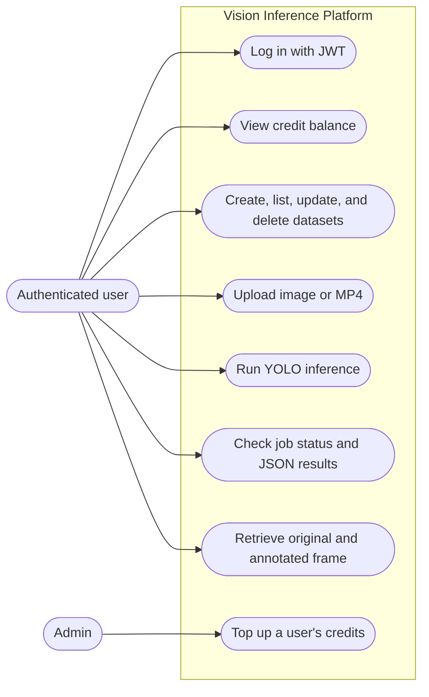
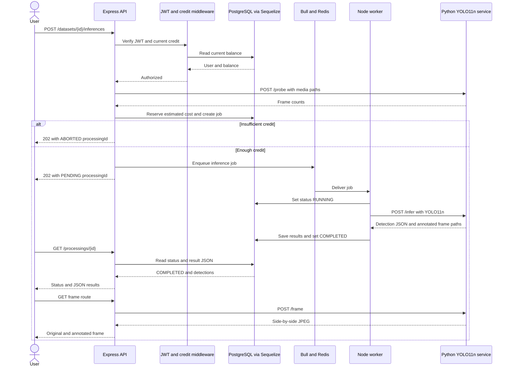

# Vision Inference Platform

Backend for the Advanced Programming exam: authenticated users organize image/video datasets, upload media, spend credits, and run object detection with YOLOv11n.

## Start locally on Windows

1. Open PowerShell in this project folder.
2. Install Node packages reproducibly: `npm ci`.
3. Run `npm run setup:env`. This creates `.env` from `.env.example` if needed and generates RS256 keys only when they are missing. The private key stays in the ignored `.env` file; keep that file for later starts so existing tokens remain verifiable.
4. Build and start all services: `docker compose up --build -d`.
5. Check the containers: `docker compose ps`.
6. Create the demo users and three datasets: `docker compose exec api npm run seed`.
7. Check the API: `Invoke-RestMethod http://localhost:3000/health`.
8. Stop services without deleting saved data: `docker compose down`.

To inspect PostgreSQL using the default `.env.example` settings, open its shell with `docker compose exec postgres psql -U yolo_user -d yolo_project`. Use `\dt` to list tables and `\q` to exit. If you changed `POSTGRES_USER` or `POSTGRES_DB`, use those values instead.

The first Docker build is large because the inference container installs Python, PyTorch, and Ultralytics. On the first inference, Ultralytics downloads the YOLO11n checkpoint into a persistent Docker volume.

Demo accounts after seeding:

- User: `demo@example.com` / `DemoPass123!`
- Admin: `admin@example.com` / `AdminPass123!`

These credentials are for local development. Change them in `.env` before the first seed if you need different demo passwords; rerunning the idempotent seed does not change existing passwords. Never commit `.env`.

## Included services and features

- **API:** Node.js, TypeScript, and Express
- **Database:** PostgreSQL through Sequelize
- **Queue:** Bull and Redis, with a separate Node worker
- **Inference:** Python service using Ultralytics with the explicit `yolo11n.pt` model
- **Authentication:** RS256 JWT login, admin role checks, and current credit checks
- **Datasets:** create, list, inspect, update, and logically delete
- **Uploads:** JPEG/PNG/WebP images and MP4 video, checked by file signature, maximum 250 MiB, with transactional credit deduction
- **Inference costs:** 4 tokens per image, 1.75 tokens per video frame; video frame count is inspected before reserving credit
- **Job statuses:** PENDING, RUNNING, FAILED, ABORTED, COMPLETED
- **Results:** detection JSON and a side-by-side original/annotated image for a completed frame
- **Credit routes:** balance lookup and admin top-up, with a transaction ledger; admins can restore a user's credit even if the admin's own balance is zero
- **Seed data:** demo user, admin, and three named datasets

The API creates its database tables with Sequelize `sync()` to simplify the course demo.

## Main API routes

- `POST /auth/login`
- `GET /datasets`
- `POST /datasets`
- `GET`, `PATCH`, or `DELETE /datasets/:id`
- `POST /datasets/:datasetId/assets/images` (multipart form field `file`)
- `POST /datasets/:datasetId/assets/videos` (multipart form field `file`)
- `GET /datasets/:datasetId/assets`
- `POST /datasets/:datasetId/inferences` with `{ "modelId": "yolo11n" }`
- `GET /processings/:processingId`
- `GET /processings/:processingId/frames/:frameNumber` (when the frame number identifies one media item)
- `GET /processings/:processingId/assets/:assetId/frames/:frameNumber`
- `GET /credits/balance`
- `POST /credits/top-up` (admin only; accepts one of `amount`, `credit`, or `newCredit` as the amount to add)

Import [`postman_collection.json`](./postman_collection.json) into Postman for example requests. Select local files manually for the two upload requests.

### Synthetic sample media

The repository provides a generator that creates a synthetic JPEG and a short 24-frame MP4 inside the inference container, then copies them into `samples/`. With Docker Compose running, use:

```powershell
docker compose build inference
docker compose up -d inference
.\scripts\generate-sample-media.ps1
```

Use `samples/sample-image.jpg` and `samples/sample-video.mp4` in the Postman upload requests. The generated files contain simple computer-drawn shapes and do not use personal or copyrighted media.

### Suggested Postman demo order

1. Run **Health**, then log in as the demo user and as admin. The login requests save their JWTs as collection variables.
2. Check the user's balance, create a dataset, then upload an image. The API deducts `0.25` token for that image.
3. Start inference. The API returns HTTP `202` with a processing ID; the job can be `PENDING` or `RUNNING` while the worker handles it. Repeat **Check processing status and results** until it reports `COMPLETED`, `FAILED`, or `ABORTED` (insufficient credit).
4. When the status is `COMPLETED`, run **Get image/frame 0 side-by-side** to see the original image and YOLO bounding boxes in one JPEG.
5. For a video demo, upload an MP4 and start inference on the dataset. The upload costs `0.08` token per KiB and inference costs `1.75` tokens per frame. After completion, use **Get video/frame 0 side-by-side** (or replace `0` with another frame number).
6. To demonstrate administrator credit management, use the admin token for **Admin top up demo user**. Dataset deletion is logical; the record is hidden from normal dataset queries.

The first inference can take longer while the Python service downloads the YOLO11n weights. Keep the status request's processing ID and repeat the status request while the worker runs.

## Design patterns and architecture

- **Singleton connections:** the database connection and Bull queue are exported once per Node process, avoiding one connection pool or queue per request.
- **Producer-consumer:** the API adds inference work to Bull; a separate worker consumes jobs so image/video processing does not hold the API request open.
- **Adapter:** `InferenceClient` provides typed `probe`, `infer`, and `renderFrame` methods around the Python service HTTP interface.
- **Layered structure:** routes handle HTTP, middleware checks authentication/authorization, services handle credit and media operations, and Sequelize models represent persisted data.

### Use-case diagram



### Inference sequence diagram



PlantUML source files remain available for the [use-case diagram](./docs/uml/use-case.puml) and [inference sequence diagram](./docs/uml/inference-sequence.puml) in `docs/uml/`.

## Tests

Run `npm test` to compile TypeScript and execute the Jest middleware tests. They cover JWT verification, admin-role authorization, zero-credit rejection and positive-credit access, UUID route-parameter validation, and client-error mapping for invalid media and oversized requests.

## Verification

The TypeScript build and Jest middleware tests pass (8 tests). Docker Compose services were started successfully. Postman verified API health, login, balance lookup, dataset creation/update/logical deletion, image and video uploads, upload charging, administrator credit top-up, image and video inference, processing status/results, and side-by-side frame retrieval. `FAILED` and insufficient-credit `ABORTED` branches are implemented but were not deliberately triggered in the demo. Keep `.env` private; only `.env.example` belongs in the public repository.
